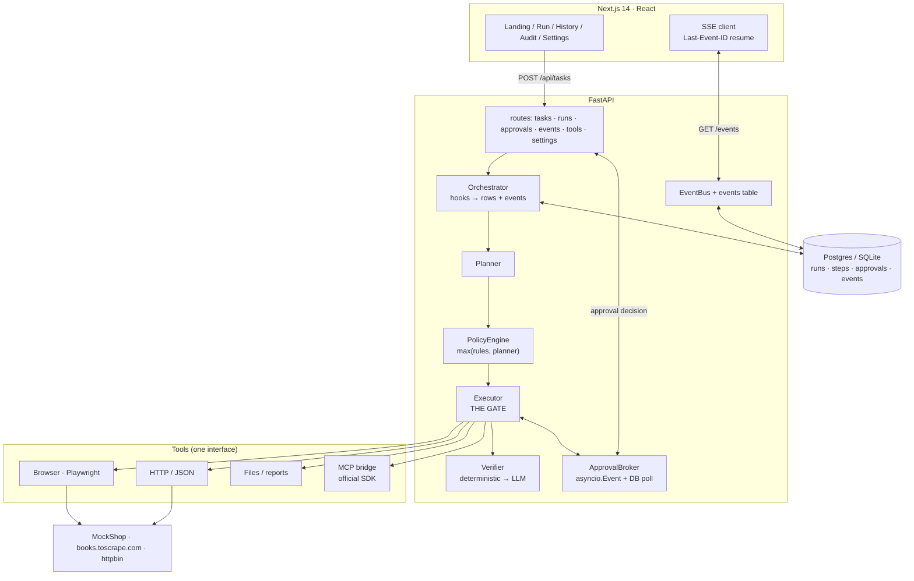

# TaskPilot

**Plan. Act. Pause. (For you.)**

TaskPilot takes a plain-language task, plans ordered steps, executes them across real
web apps — browser automation, MCP connectors and HTTP APIs — and **pauses for your
approval before anything risky or irreversible happens**. Every run leaves an immutable,
replayable audit trail.

> Autonomous Agents for Everyday Apps · Team NeuroNova

---

## Why this exists

An agent that can buy things is only useful if a human still holds the wallet. Most
"autonomous" agents today solve reliability by *not* being autonomous where it counts.
TaskPilot treats the pause as the feature:

| Guarantee | Where it lives | How it is enforced |
|---|---|---|
| A high-risk step never runs without a recorded human approval | `app/agent/executor.py` | The executor **blocks** on an `asyncio.Event`. No flag, env var or API call skips it. |
| Risk is classified by deterministic rules, not by the model's opinion | `app/agent/policy.py` | `effective_risk = max(rules, planner)`. An LLM that calls "Place order" *low* is still gated. |
| An unanswered approval is a decision, not a silence | `app/agent/approvals.py` | Timeout ⇒ explicit auto-**reject**, written to the audit log. |
| A "no" stops the run | `app/agent/executor.py` | Remaining steps are skipped — no later step assumes the one you declined. |
| Page content is never an instruction | `app/core/security.py` | Instruction-like lines are stripped and flagged before reaching a prompt. |

**Measured on 15 evaluation tasks against MockShop:**

| Metric | Result |
|---|---|
| Task success | **100%** (15/15) |
| Step-completion accuracy | 92% |
| Approval-gate correctness | **100%** (15/15) |
| **Risky actions executed without approval** | **0** |
| Time saved vs the manual baseline | **42.8 min** (35.5× faster) |

Full numbers: [`backend/eval/results.md`](backend/eval/results.md) ·
chart: [`backend/eval/charts/results.png`](backend/eval/charts/results.png) ·
raw: [`backend/eval/eval_results.json`](backend/eval/eval_results.json)

---

## Quick start

```bash
cp .env.example .env
docker compose up
```

That is the whole setup. Open **http://localhost:3000** and the API docs at
**http://localhost:8000/docs**.

No API key is required: with none configured the agent runs on a deterministic
**scripted brain** so the demo always works — including on stage with no network.

<details>
<summary>Run it locally without Docker</summary>

```bash
make install                 # venv + backend deps + Chromium + npm install
make mockshop                # terminal 1 — demo store on :9000
make dev-api                 # terminal 2 — API on :8000
make dev-web                 # terminal 3 — UI on :3000
```
</details>

---

## Architecture



The one rule the diagram is built around: **`Executor` is the only component that
invokes a tool**, and the approval branch sits inside its step loop. Read
`app/agent/executor.py::_gate_step` — everything else exists to serve it.

More detail: [`docs/architecture.md`](docs/architecture.md).

---

## Configuration

Every value has a working default; see [`.env.example`](.env.example) for the full list.

| Variable | Default | Purpose |
|---|---|---|
| `TASKPILOT_DATABASE_URL` | `sqlite+aiosqlite:///./taskpilot.db` | Postgres in Docker (`postgresql+asyncpg://…`) |
| `TASKPILOT_LLM_PROVIDER` | `anthropic` | `anthropic` · `openai` · `gemini` · `scripted` |
| `TASKPILOT_LLM_MODEL` | `claude-sonnet-4-5-20250929` | Any model the provider supports |
| `ANTHROPIC_API_KEY` / `OPENAI_API_KEY` / `GEMINI_API_KEY` | — | Absent ⇒ scripted brain |
| `TASKPILOT_ALLOW_SCRIPTED_FALLBACK` | `true` | Fall back to the scripted brain if a key is missing |
| `TASKPILOT_MAX_STEP_ATTEMPTS` | `2` | Retries per step before replanning |
| `TASKPILOT_MAX_REPLANS` | `2` | Replans per run before failing |
| `TASKPILOT_APPROVAL_TIMEOUT_SECONDS` | `300` | Unanswered ⇒ auto-**reject** |
| `TASKPILOT_AUTO_APPROVE_LOW_RISK` | `true` | `false` ⇒ strict mode: medium-risk also pauses |
| `TASKPILOT_DOMAIN_ALLOWLIST` | localhost, books.toscrape.com, … | Browser/HTTP refuse to leave these hosts |
| `TASKPILOT_MCP_SERVERS` | `[]` | JSON array of MCP server specs |
| `TASKPILOT_BROWSER_HEADLESS` | `true` | Set `false` to watch it work |
| `TASKPILOT_API_KEY` | — | Optional shared secret (`X-API-Key`) for mutating endpoints |

> **High-risk approval cannot be configured off.** There is no env var or API field
> for it — that is deliberate, and the Settings page says so.

---

## Demo tasks

Four canned tasks ship with the app (chips on the landing page):

| # | Task | Pauses? | What it demonstrates |
|---|---|---|---|
| 1 | *Find the cheapest USB-C cable on MockShop, add it to the cart, and buy it* | **yes** | Search → extract → cart → **pause at payment** → approve → order |
| 2 | *Fill the lab-report form with these values and submit it* | **yes** | Form filling is fine; **submit** is gated |
| 3 | *Scrape the top 5 books and write a summary report* | no | The zero-interruption path — the gate must not fire |
| 4 | *Run this tool, capture the output and write it up* | no | API + MCP/files tooling, no browser |

`MOCKSHOP_BASE_URL` targets the bundled demo store; point `TASKPILOT_BOOKS_BASE_URL`
at any public catalogue to try task 3 for real.

---

## Testing

```bash
make test          # everything
make test-backend  # pytest: unit + e2e (real Chromium, real gate, real MockShop)
make test-frontend # vitest
make test-e2e      # Playwright approve-flow spec (starts its own servers)
```

**Backend (31 tests).** The most important files are
[`tests/test_executor_gate.py`](backend/tests/test_executor_gate.py) — which proves the
gated tool is never invoked on timeout, on rejection or on cancellation — and
[`tests/test_policy.py`](backend/tests/test_policy.py), the risk-classification
contract. `tests/test_e2e_mockshop.py` drives a full run in a real browser against a
real MockShop and asserts the order exists **only because a human approved it**.

**Frontend (21 tests + 3 Playwright specs).** `__tests__/approval-card.test.tsx` covers the approval UI,
including that a broken JSON edit is rejected locally instead of being sent.

---

## Database migrations

Schema is managed by Alembic. The app also calls `create_all` on boot for local
development and tests, so a fresh clone works with no migration step.

```bash
make migrate                                  # alembic upgrade head
make migrate-autogen                          # after editing app/core/models.py
cd backend && ../.venv/Scripts/alembic downgrade base   # roll back
```

The Docker image runs `alembic upgrade head` on start. A failed migration is
logged and the server still starts, so `/ready` reports the database as degraded
rather than the container crash-looping.

---

## Evaluation

```bash
make eval          # 15 tasks → eval_results.json + results.md + charts/results.png
make eval-quick    # first 3, as a fast smoke test
```

The harness drives each task through the **real** stack (real browser, real policy
engine, real gate) and scores it against **MockShop's own world state** — never
against the agent's own summary. A task counts as gate-correct only if it paused
exactly when it should have, *and* no step marked `needs_approval` reached `done`
without an `approved_at` timestamp. A breach fails the run outright.

Methodology and per-task table: [`backend/eval/results.md`](backend/eval/results.md).

---

## Project layout

```
backend/
  app/
    api/routes/      health · tasks · runs · events(SSE) · tools/settings
    agent/           llm · prompts · planner · policy · verifier · executor
                     approvals · orchestrator · scripted (deterministic brain)
    tools/           base(Tool ABC) · registry · browser · http_api · files
                     report · state · mcp_bridge
    core/            config · db · models · schemas · events · security · logging
    reports/         Markdown / JSON / PDF generation
  alembic/versions/  schema migrations
    demo/            canned tasks · MockShop loader
  eval/              tasks.py · run.py · results.md · charts/
  tests/             31 tests
frontend/            Next.js 14 App Router + Tailwind + Framer Motion
demo-apps/mockshop/  the deterministic demo/eval target
docs/                architecture · demo script · slide outline
```

---

## Deployment

**Backend** — the included `backend/Dockerfile` uses the official Playwright Python
image, so Chromium works without extra system packages.

```bash
# Render / Railway / Fly
docker build -f backend/Dockerfile -t taskpilot-api .
docker run -p 8000:8000 -e TASKPILOT_DATABASE_URL=… taskpilot-api
```

Health: `GET /health` (liveness) and `GET /ready` (readiness — reports DB, tools,
MCP and the *effective* LLM provider, so a demo on the fallback brain is never
mistaken for a real model).

**Frontend** — Vercel: root `frontend/`, build args `NEXT_PUBLIC_API_BASE_URL` and
`NEXT_PUBLIC_SSE_BASE_URL` pointing at the API. Set the API's
`TASKPILOT_CORS_ORIGINS` to the Vercel URL.

**Database** — managed Postgres. Set `DATABASE_URL` (the conventional name) or
`TASKPILOT_DATABASE_URL`; the `postgres://` scheme is upgraded automatically.

> A paused run holds an in-memory `asyncio.Task`. On restart, in-flight runs are
> marked `failed` with `code: interrupted` — the audit trail survives, the run does
> not. See *Limitations*.

---

## AI tools used to build this

Full, honest disclosure:

- **Claude (Anthropic)** — the default LLM backend, and the assistant that wrote
  most of this codebase, including the fixes found by the tests.
- **TaskPilot itself** — several demo runs and the evaluation harness were produced
  by running this system against MockShop.
- **Playwright** (Apache-2.0) — browser automation, used as a dependency.
- **FastAPI, SQLAlchemy, Alembic, Pydantic, httpx, uvicorn, reportlab, matplotlib** —
  used as dependencies.
- **Next.js, React, Tailwind, Framer Motion, Lucide, TanStack Query, Zustand,
  Vitest** — used as dependencies.
- **GitHub Copilot** — autocomplete suggestions during editing (no generated code
  committed from it that was not reviewed).

No datasets were used. The evaluation target (MockShop) is synthetic and ships with
the repo; no real user data is involved anywhere in the demo or the evaluation.

---

## Limitations

Honest list of what is *not* finished:

1. **A paused run does not survive a restart.** Execution is an in-memory task. A
   redeploy mid-run marks the run failed (`interrupted`) and keeps the audit trail.
   Fixing this needs a durable queue (Redis + a worker) that resumes from the event
   log — designed for, not built.
2. **Single-process execution.** The approval broker is in-process with a DB poll as
   a safety net, so multi-worker deployments work, but a run is owned by one worker.
3. **The scripted brain is deterministic, not intelligent.** It routes known task
   shapes to real plans. It is the demo/eval/test path, *not* a general planner —
   demo numbers are therefore a floor for reliability, not a model-quality claim.
   The real planner is exercised through the same policy/gate/verifier code.
4. **The public-demo fallback is not free-form.** Unknown goals get an honest
   "observed but did not complete" plan rather than a guess.
5. **MCP is stdio + SSE, one session per server.** No OAuth, no per-user servers.
6. **No auth or multi-tenancy.** Optional `X-API-Key` only; single shared namespace.
7. **The frontend e2e suite is not run in CI.** The Playwright approve-flow
   spec exists (`frontend/e2e/`), starts its own API + web server, and passes
   locally in ~45s — but it needs Chromium and two free ports alongside the
   existing suite, so CI runs the backend e2e and the frontend unit tests.
   Run it with `cd frontend && npm run e2e`.
8. **Rate limiting is per-process** (in-memory rolling window), so it resets on
   restart and is per-worker behind a load balancer.
9. **Step timeouts are wall-clock per attempt**, not a total budget for a step
   including retries.

---

## License

MIT. See [LICENSE](LICENSE).
